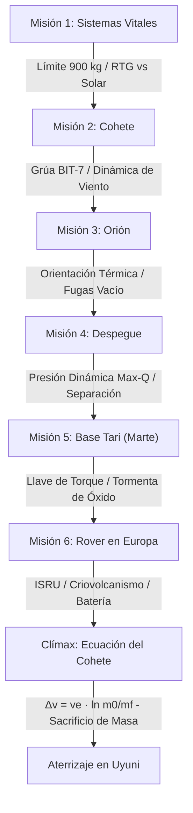

# 🚀 Misión Cóndor — ARQUISOFT

> **Videojuego web educativo de diseño de misiones aeroespaciales e ingeniería de sistemas espaciales.**  
> Desarrollado por el equipo boliviano **ARQUISOFT** para el **NASA Space Apps Challenge 2026** (Reto: *Space Mission Design Game*).

[](https://opensource.org/licenses/Apache-2.0)
[](https://phaser.io/)
[](https://www.typescriptlang.org/)
[](https://vitejs.dev/)
[](https://nodejs.org/)
[](https://playwright.dev/)

---

## 📋 Tabla de Contenidos

1. [Título y Descripción Ejecutiva](#-título-y-descripción-ejecutiva)
2. [Arquitectura y Estructura del Proyecto](#-arquitectura-y-estructura-del-proyecto)
3. [Tecnologías y Stack Utilizado](#-tecnologías-y-stack-utilizado)
4. [Mecánicas de Juego Principales](#-mecánicas-de-juego-principales)
5. [Instalación y Ejecución Local](#-instalación-y-ejecución-local)
6. [Pruebas Automatizadas y QA](#-pruebas-automatizadas-y-qa)
7. [Créditos y Licencia](#-créditos-y-licencia)

---

## 🛰️ Título y Descripción Ejecutiva

### ¿Qué es Misión Cóndor?
**Misión Cóndor** es una experiencia interactiva web, narrativa y de simulación científica que traslada al jugador al papel de un/a ingeniero/a aeroespacial situado en la **Ciudadela de la Tierra** (Salar de Uyuni, Bolivia). En un futuro donde una anomalía atmosférica crítica agota el oxígeno del planeta, el protagonista emprende una odisea a través del Sistema Solar (con escalas en Venus, Marte y el océano subsuperficial de Europa, luna helada de Júpiter) para recuperar un microorganismo extremófilo capaz de devolverle el aire a la Tierra… impulsado por la promesa de volver junto a su mascota.

### Enfoque Educativo Aeroespacial
El proyecto sigue el principio fundamental de ingeniería: **«Conceptos antes que Código»**. En lugar de ser un simple juego arcade, *Misión Cóndor* traduce la ingeniería de sistemas espaciales en mecánicas tangibles, abordando:
- **Gestión rigurosa de presupuestos técnicos:** masa seca, masa húmeda, potencia eléctrica ($W$) y balances de enlace de comunicaciones.
- **Leyes de la física y astronáutica aplicada:** Ley de la inversa del cuadrado de la distancia para radiación solar, presión dinámica máxima ($Max\text{-}Q$), leyes de radiación y la formulación exacta de la **Ecuación del Cohete de Tsiolkovsky**.
- **Ingeniería de supervivencia y recursos in situ (ISRU):** Electrólisis criogénica para generar $O_2$ y propelente ($H_2/O_2$) a partir del hielo de Europa.
- **Accesibilidad universal (Zero-Friction):** Ejecución inmediata en cualquier navegador moderno de escritorio o móvil sin descargas ni instalaciones pesadas, manteniendo 60 FPS estables.

---

## 🏗️ Arquitectura y Estructura del Proyecto

El sistema está diseñado bajo una arquitectura modular y desacoplada, separando la lógica de simulación, la orquestación de escenas, la gestión del estado global y el motor gráfico de renderizado de sprites.

```mermaid
flowchart TD
    subgraph Cliente ["Cliente Web (Phaser 3 + TypeScript)"]
        Index[index.html] --> Main[src/main.ts]
        Main --> Flujo[core/flujo.ts - Orquestador de Escenas]
        Flujo --> Escenas[scenes/*.ts - 6 Misiones + Cinemáticas + Clímax]
        Escenas --> UI[ui/*.ts - Componentes Holográficos & HUD]
        Escenas --> Sprites[core/sprites.ts - Render 2.5D & Colisiones]
        Escenas --> Audio[core/audio.ts & musica.ts - Web Audio]
        Escenas --> Red[core/red.ts - Cliente WebSocket]
        Escenas --> Estado[core/estado.ts - Persistencia Local]
    end

    subgraph Backend ["Servidor Ligero (Node.js Autónomo)"]
        Server[herramientas/servir.mjs]
        Server --> WS[WebSocket RFC 6455 Nativo]
        Server --> DB[(SQLite: node:sqlite)]
        Server --> HTTP[Servidor Estático SPA]
    end

    Red <-->|WebSocket /ws (JSON)| WS
```

### Distribución de Directorios

```text
MisionCondor-ArquiSoft-Nasa/
├── .github/                # Flujos de trabajo de CI/CD para GitHub Actions
├── docs/                   # Documentación técnica, arquitectónica y guiones de diseño
│   ├── ARQUITECTURA.md     # Especificación de capas, escenas y ciclo de renderizado
│   ├── STACK_TECNOLOGICO.md# Detalle técnico de herramientas, decisiones y dependencias
│   ├── GUION.md            # Guion literario y cinematográfico completo
│   ├── QA.md               # Matriz de aseguramiento de calidad y pruebas cruzadas
│   ├── DEPLOY.md           # Guías de despliegue para Render, Fly.io y GitHub Pages
│   └── SPRITES.md          # Catálogo e índice de moldes y hojas de animación
├── herramientas/           # Tooling y scripts utilitarios en Node.js (cero dependencias externas)
│   ├── moldes/             # Motor de rasterización vóxel 2.5D y catálogo 3D (Hangar)
│   ├── atlas.mjs           # Generador e indexador de public/sprites/atlas.json
│   ├── servir.mjs          # Servidor HTTP + WebSocket nativo con SQLite embebido
│   ├── servir-moldes.mjs   # Servidor de desarrollo para exportación de hojas de sprites
│   └── empaquetar.mjs      # Compilador de distribución portable fuera de línea (.zip)
├── public/                 # Activos estáticos servidos sin procesamiento
│   ├── audio/              # Pistas musicales adaptativas (.mp3)
│   ├── coop/               # Escenarios declarativos para el modo cooperativo (JSON)
│   └── sprites/            # Atlas global y hojas de sprites organizadas por categoría
├── src/                    # Código fuente de la aplicación (TypeScript)
│   ├── config.ts           # Configuración de lienzo (960x540), paleta CSS y fuentes
│   ├── main.ts             # Punto de entrada, configuración de Phaser e inyección de i18n
│   ├── core/               # Núcleo de lógica y subsistemas transversales
│   │   ├── estado.ts       # Modelo de datos del jugador y guardado en localStorage
│   │   ├── flujo.ts        # Máquina de estados finitos del flujo de la aventura
│   │   ├── sprites.ts      # Carga desde atlas, animaciones 8-direcciones y colisiones elípticas
│   │   ├── audio.ts        # Subsistema de audio procedural (Web Audio API)
│   │   ├── musica.ts       # Gestor musical dinámico con fundidos cruzados
│   │   ├── idioma.ts       # Motor de internacionalización y traducción en caliente (ES/EN)
│   │   ├── misiones.ts     # Registro canónico y cómputo de estrellas de misiones
│   │   ├── dificultad.ts   # Moduladores de dificultad (Cadete vs. Ingeniería)
│   │   ├── red.ts          # Capa de transporte WebSocket para multijugador
│   │   └── voz.ts          # Integración de síntesis de voz (Web Speech API)
│   ├── data/               # Modelos de datos estáticos y narrativos
│   │   ├── historia.ts     # Estructura declarativa de cuadros cinemáticos
│   │   ├── guias.ts        # Contenido pedagógico, objetivos y controles por misión
│   │   ├── archivo.ts      # Enciclopedia interactiva, integrantes y reto NASA
│   │   └── en.ts           # Diccionario inglés y reglas de traducción contextual
│   ├── scenes/             # Controladores de escenas de Phaser
│   │   ├── Arranque.ts     # Pre-carga crítica de recursos y atlas
│   │   ├── Titulo.ts       # Portada principal, selector de modos y créditos
│   │   ├── Registro.ts     # Onboarding: nombre, pronombres y mascota
│   │   ├── Cinematica.ts   # Motor de cinemáticas sincronizadas por audio y texto
│   │   ├── Mision1Sistemas.ts  # Misión 1: Balance de masa y energía (900 kg)
│   │   ├── Ensamblaje.ts   # Clase base para minijuegos de montaje secuencial
│   │   ├── Mision2Cohete.ts    # Misión 2: Integración vertical de etapas de cohete
│   │   ├── Mision3Orion.ts     # Misión 3: Ensamblaje de cápsula tripulada y vacío
│   │   ├── Mision4Despegue.ts  # Misión 4: Simulación de ascenso, Max-Q y etapas
│   │   ├── MisionMarte.ts      # Misión 5: Tormenta de polvo en Base Tari y torque
│   │   ├── Mision5Rover.ts     # Misión 6: Exploración en Europa y sistema ISRU
│   │   ├── Ecuacion.ts     # Clímax: Decisión interactiva con la ecuación de Tsiolkovsky
│   │   ├── Pausa.ts        # Menú contextual de pausa y ajustes en vivo
│   │   ├── MultiLobby.ts   # Sala de emparejamiento para modo cooperativo
│   │   ├── Coop.ts         # Escena multijugador asimétrica (Ingeniero / Recolector)
│   │   └── Fin.ts          # Epílogo, resumen de logros y pantalla final
│   └── ui/                 # Biblioteca de componentes visuales (Atomic UI)
│       ├── boton.ts        # Botones holográficos reactivos, cintillos y avisos
│       ├── taller.ts       # Dron BIT-7, pedestales, listas holográficas y escáner
│       ├── palanca.ts      # Joystick virtual adaptativo para pantallas táctiles
│       ├── decorado.ts     # Generación procedural de suelos y horizontes
│       └── ambiente.ts     # Emisores de partículas (polvo, chispas, escarcha)
├── tests/                  # Suite integral de pruebas automatizadas
│   ├── logica/             # Pruebas unitarias de reglas de negocio y coop
│   ├── servidor/           # Pruebas de integración de salas, sincronización y SQLite
│   └── e2e/                # Pruebas de extremo a extremo con Playwright (PC / Móvil)
├── Dockerfile              # Empaquetado en contenedor listo para producción
├── docker-compose.yml      # Orquestación de entorno contenerizado local
├── fly.toml                # Configuración de despliegue en Fly.io
├── render.yaml             # Manifiesto de infraestructura como código para Render
├── playwright.config.ts    # Configuración de pruebas cross-browser y multi-dispositivo
└── package.json            # Manifiesto de dependencias y scripts de automatización
```

---

## 💻 Tecnologías y Stack Utilizado

### Frontend y Motor Gráfico
- **Phaser 3.90.0:** Motor 2D de alto rendimiento con renderizador WebGL nativo y respaldo automático a HTML5 Canvas. Configurado con resolución virtual fija de $960 \times 540$ y modo `Scale.FIT` con `roundPixels: true` para garantizar nitidez matemática en pantallas de alta densidad (Retina/OLED).
- **TypeScript 5.9.3:** Tipado estático estricto en toda la arquitectura del juego, reduciendo drásticamente fallas de runtime entre transiciones de escenas.
- **Vite 7.1.12:** Entorno de empaquetado ultrarrápido con Hot Module Replacement (HMR) y separación optimizada de fragmentos en producción (`manualChunks` aislando a Phaser en su propio bundle).

### Pipeline Gráfico e Isometría 2.5D Propia
- **Motor de Moldes Vóxel 2.5D (`herramientas/moldes/engine.js`):** Rasterizador de vóxeles propio desarrollado en JavaScript que transforma prismas y geometrías 3D básicas en pixel art isométrico proyectado en 8 direcciones con 8 cuadros de animación por dirección.
- **Doble Capa Emisiva con Brillo Aditivo:** Cada sprite exporta su textura difusa base y un mapa `_brillo.png` renderizado mediante `BlendModes.ADD`, evitando la sobrecarga de shaders complejos en chips gráficos móviles de gama media y baja.
- **Huella Física y Detección de Colisiones Elípticas:** Cada molde declara su propiedad `foot: [x, z]` proyectada automáticamente a elipses de colisión en tiempo de ejecución (`cuerposDe` y función de resolución suave `empujar`), eliminando la necesidad de incorporar un motor físico pesado como Matter.js o Box2D.

### Audio, Música y Síntesis
- **Web Audio API Procedural (`src/core/audio.ts`):** Síntesis algorítmica de efectos de sonido (osciladores periódicos, filtros pasa-bajos y generadores de ruido blanco) para interfaces, alarmas, motores y pasos, requiriendo 0 KB de archivos externos de audio para efectos.
- **Banda Sonora Adaptativa:** 8 pistas musicales orquestadas (`public/audio/`) sincronizadas dinámicamente según la fase de la misión mediante fundido cruzado (`cross-fade`).
- **Web Speech API:** Módulo opcional de accesibilidad y narración por voz sintetizada en el idioma del usuario.

### Backend y Multijugador
- **Node.js (>= 22.5):** Servidor centralizado sin dependencias de terceros para WebSockets (`herramientas/servir.mjs`). Implementación artesanal del protocolo **RFC 6455** sobre `node:http` (handshake SHA-1 y tramas binarias/texto optimizadas $\le 64\text{ KB}$).
- **SQLite Nativo (`node:sqlite`):** Motor de base de datos embebido en Node para la gestión de salas, persistencia de jugadores y tablas de puntuación clasificatoria.

### Internacionalización y Tipografías
- **Traductor en Caliente Zero-Cost (`src/core/idioma.ts`):** Intercepción del método `Phaser.GameObjects.Text.prototype.setText` para traducir dinámicamente toda la interfaz entre Español e Inglés sin refactorizar escena por escena, adaptando pronombres de acuerdo al perfil configurado.
- **Fuentes Locales Empaquetadas:** `@fontsource/press-start-2p` y `@fontsource/open-sans` para garantizar funcionamiento autónomo e idéntico sin conexión a la red.

---

## ⚙️ Mecánicas de Juego Principales



### 1. Gestión de Masa, Potencia y Balances de Enlace (Misión 1)
- **Restricción de Masa Estructural:** El vehículo espacial de transferencia posee un tope estricto de **$900\text{ kg}$**. Superar este umbral impide la validación técnica del módulo.
- **Ley de la Inversa del Cuadrado de la Radiación Solar:** El jugador debe elegir la fuente de potencia. Un panel solar de $80\text{ kg}$ genera $300\text{ W}$ en la Tierra pero se degrada a tan solo $12\text{ W}$ en Júpiter (debido a que recibe únicamente el $4\%$ del flujo solar). Para garantizar la misión, el jugador debe balancear el peso adicional de un generador termoeléctrico de radioisótopos (**RTG**) de plutonio ($150\text{ kg}$, $110\text{ W}$ constantes).
- **Compromiso de Telecomunicaciones:** Selección entre antenas omnidireccionales ligeras y antenas parabólicas de alta ganancia para espacio profundo con mayor penalización de masa.

### 2. Ensamblaje Aeroespacial con Dinámica de Grúa y Viento (Misiones 2 y 3)
- **Secuencia de Etapas:** Montaje vertical respetando la jerarquía estructural de un lanzador pesado: propulsores sólidos (SRB), núcleo criogénico, etapa superior y cofia de carga.
- **Acoplamiento con Tolerancia a Oscilaciones:** El dron asistencial **BIT-7** levanta las piezas con un rayo tractor. El jugador debe compensar el balanceo armónico provocado por el viento del Salar y soltar la pieza dentro de un margen de tolerancia ($\le 7\text{ px}$ para encaje perfecto).
- **Enrutamiento de Propelentes y Vacío:** Minijuegos de conexión de tuberías de combustible líquido y detección/sellado de fugas en la cápsula Orión bajo pruebas de vacío hiperbárico.

### 3. Simulación de Ascenso Atmosférico y Max-Q (Misión 4)
- **Perfil de Ascenso y Aerodinámica:** Simulación basada en los hitos de vuelo de un lanzador SLS real (desprendimiento de propulsores a $\sim 126\text{ s}$ / $5000\text{ km/h}$; corte de etapa central a $\sim 480\text{ s}$ / $28000\text{ km/h}$).
- **Control de Presión Dinámica ($Max\text{-}Q$):** Entre el $28\%$ y el $66\%$ de la fase inicial, el cohete atraviesa la región de máxima presión aerodinámica. El jugador debe desacelerar el empuje ($Throttle \le 0.65$) para evitar la sobrecarga y el fallo estructural del fuselaje.
- **Eficiencia de Separación:** Desprender las etapas agotadas a tiempo evita arrastrar «masa muerta», mientras que separarlas prematuramente desperdicia impulso específico útil.

### 4. Mantenimiento Extremo en Marte: Base Tari (Misión 5)
- **Tormenta de Óxido y Obstrucción Fotovoltaica:** Los paneles solares del Rover quedan sepultados por polvo marciano fino, anulando la generación eléctrica de la base.
- **Herramientas de Torque:** El astronauta debe desplazarse en medio de una densa tormenta con visibilidad reducida, esquivar vórtices convectivos y aplicar la **llave de torque** manteniendo el accionamiento manual para liberar los actuadores mecánicos y limpiar las celdas antes de agotar la reserva vital de $O_2$.

### 5. Exploración Criogénica y Sistema ISRU en Europa (Misión 6)
- **Utilización de Recursos In Situ (ISRU):** En la superficie a $-160\text{ }^\circ\text{C}$ de Europa, el Rover debe localizar bloques de hielo de agua mediante pulsos de sonar y transportarlos al **Electrolizador criogénico**, convirtiendo el agua local en oxígeno respirable y propelente líquido bipropelente ($LH_2 / LOX$).
- **Gestión Térmica y Radiación:** La barrena del taladro de muestreo acumula calor por fricción criogénica exigiendo pausas de enfriamiento; simultáneamente, la distancia a la nave incrementa la exposición al cinturón de radiación ionizante de Júpiter.

### 6. Clímax: La Ecuación del Cohete de Tsiolkovsky
El clímax del juego implementa directamente la física de la astronáutica mediante la ecuación fundamental de Tsiolkovsky:

$$\Delta v = v_e \cdot \ln\left(\frac{m_{\text{seca}} + m_{\text{combustible}}}{m_{\text{seca}}}\right)$$

- **Parámetros del Sistema:** Velocidad de escape efectiva de los gases $v_e = 3.0\text{ km/s}$, combustible sintetizado mediante ISRU $m_{\text{combustible}} = 2260\text{ kg}$, masa base de la estructura $m_{\text{estructura}} = 1155\text{ kg}$.
- **Requerimiento Orbital:** Para escapar de la gravedad del sistema joviano y regresar a la Tierra se exige un $\Delta v \ge 2.80\text{ km/s}$.
- **Dilema del Ingeniero:** Con todas las cargas y muestras a bordo, el $\Delta v$ alcanza solo $2.67\text{ km/s}$. Desprender instrumentos secundarios resulta insuficiente ($2.78\text{ km/s}$). La única combinación matemáticamente viable obliga al jugador a dejar en Europa al **Rover explorador** ($180\text{ kg}$), elevando el $\Delta v$ a $2.89\text{ km/s}$ para salvar la misión.

### 7. Modo Cooperativo Multijugador Asimétrico
- **Ingeniero:** Opera desde la mesa de control del hangar, monitoreando la masa total, calibrando piezas y emitiendo órdenes de suministros.
- **Recolector:** Explora físicamente el escenario con capacidad de carga limitada (hasta $150\text{ kg}$ por compartimento en el carro de transporte), esquivando obstáculos y entregando las piezas en la zona de transferencia.

---

## 🚀 Instalación y Ejecución Local

### Prerrequisitos
- **Node.js:** Versión `>= 22.5.0` (recomendado Node 22 LTS o superior para soporte de `node:sqlite`).
- **NPM:** Gestor de paquetes incluido con Node.js.
- **Git:** Para clonar el repositorio.

### 1. Clonar el Repositorio
```bash
git clone https://github.com/RonaldRodriguez/MisionCondor-ArquiSoft-Nasa.git
cd MisionCondor-ArquiSoft-Nasa
```

### 2. Instalar Dependencias
Instala los paquetes necesarios (Phaser, fuentes locales y herramientas de desarrollo):
```bash
npm install
```

### 3. Ejecutar en Modo Desarrollo
Inicia el servidor local de desarrollo impulsado por Vite:
```bash
npm run dev
```
Abre tu navegador en `http://localhost:5173`. Para acceder desde celulares o tabletas en la misma red Wi-Fi, utiliza la dirección IP local mostrada en la terminal.

*(Opcional) Si deseas probar las funciones multijugador en desarrollo, ejecuta en una terminal secundaria:*
```bash
npm run servidor
```
El servidor WebSocket iniciará en el puerto `8787`.

### 4. Empaquetado para Producción y Modo Offline
El proyecto incluye un pipeline automatizado para generar una versión 100% autónoma y jugable sin conexión a internet:
```bash
npm run empaquetar
```
Este comando ejecuta la comprobación de tipos (`tsc`), compila el bundle estático con Vite, integra el servidor embebido `servir.mjs` y genera el archivo **`dist/MisionCondor.zip`** junto con los ejecutables `iniciar.bat` (Windows) e `iniciar.sh` (Linux/macOS).

### 5. Ejecución con Docker
Si prefieres un entorno contenerizado estándar:
```bash
# Construir y levantar con Docker Compose
docker-compose up --build
```
La aplicación estará disponible inmediatamente en `http://localhost:8080`.

---

## 🧪 Pruebas Automatizadas y QA

El proyecto cuenta con una batería integral de pruebas unitarias, de integración y end-to-end con Playwright para asegurar estabilidad cross-platform:

```bash
# Ejecutar pruebas unitarias de lógica y servidor WebSocket (Node Test Runner)
npm test

# Ejecutar pruebas E2E completas en navegadores emulados (PC, Celular y Tablet)
npm run test:e2e

# Ejecutar toda la suite de control de calidad (Unitarias + E2E)
npm run qa

# Visualizar el reporte interactivo de Playwright
npm run qa:reporte
```

### Atajos de Depuración por Parámetros URL
Para auditar escenas y mecánicas de manera aislada durante el desarrollo:
- `?escena=Mision1Sistemas` (o cualquier otra escena: `Mision4Despegue`, `MisionMarte`, `Mision5Rover`, `Ecuacion`).
- `?escena=Cinematica&bloque=climax` (prueba directa del motor narrativo).
- `?cuerpos` (renderiza las elipses de colisión y cajas de choque en pantalla).
- `?idioma=en` (fuerza la interfaz y textos en inglés).
- `?prueba` (ejecuta un bucle desatendido con temporizador apto para pestañas en segundo plano).

---

## 👥 Créditos y Licencia

### Equipo ARQUISOFT
Proyecto conceptualizado, diseñado y programado por el equipo boliviano **ARQUISOFT** para el **NASA Space Apps Challenge 2026**:

- **Ronald Augusto Rodriguez Serrano**
- **Carla Loayza Leiguez**
- **Gabriela Belén Crespo Cárdenas**
- **Roby Daniel Duran Aguilar**
- **Victor Hugo Murillo Siles**
- **Helen Valeria Montaño Gutierrez**

*«Hacer que la ciencia y la ingeniería espacial se sientan cercanas: que cualquier persona, con un celular y sin instalar nada, entienda por qué cada kilo, cada vatio y cada gota de combustible importan.»*

---

### Licencia

Este proyecto está distribuido bajo la licencia **Apache License 2.0**.  
Eres libre de usar, modificar, bifurcar y distribuir este software conforme a los términos y condiciones estipulados en la licencia. Consulta los términos oficiales en [Apache 2.0 License](https://www.apache.org/licenses/LICENSE-2.0).

```text
Copyright 2026 ARQUISOFT

Licensed under the Apache License, Version 2.0 (the "License");
you may not use this file except in compliance with the License.
You may obtain a copy of the License at

    http://www.apache.org/licenses/LICENSE-2.0

Unless required by applicable law or agreed to in writing, software
distributed under the License is distributed on an "AS IS" BASIS,
WITHOUT WARRANTIES OR CONDITIONS OF ANY KIND, either express or implied.
See the License for the specific language governing permissions and
limitations under the License.
```
